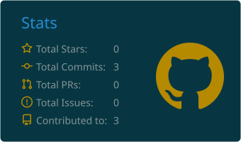
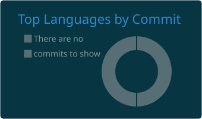

<!-- BANNER ANIMADO -->

 

---

## 📊 Estatísticas do GitHub

  

---

## 📈 Minha atividade no GitHub

---

## 👨‍💻 Sobre mim

Sou estudante de **Sistemas de Informação no IFMG**, interessado em desenvolvimento de software, bancos de dados, desenvolvimento web e robótica.

Tenho conhecimentos em diferentes linguagens de programação e tecnologias, e busco aprimorar minhas habilidades por meio de projetos práticos e da resolução de problemas.

- 💡 Interesse em desenvolvimento de software.
- 🗄️ Estudos e práticas com bancos de dados relacionais.
- 🌐 Desenvolvimento de páginas e aplicações web.
- ⚙️ Aplicações desktop com Java Swing e .NET.
- 🤖 Robótica e sistemas embarcados com Arduino.
- 🔧 Controle de versão com Git e GitHub.
- 📈 Construindo meu portfólio profissional continuamente.

🚀 **Meu objetivo é transformar conhecimento em prática e desenvolver soluções que contribuam para minha carreira como profissional de TI.**

---

## 🛠️ Tecnologias e ferramentas

### 💻 Linguagens de programação

### ⚙️ Plataformas e frameworks

### 🌐 Desenvolvimento web

### 🗄️ Banco de dados

### 🤖 Robótica e sistemas embarcados

### 🔧 Ferramentas de desenvolvimento

---

## 🚀 Projetos em destaque

| Projeto | Descrição |
|---|---|
| [Sistema-Login-Java-MySQL](https://github.com/kcarloshlima/Sistema-Login-Java-MySQL) | Tela de login desktop em Java Swing com autenticação via MySQL/JDBC |
| [Sistema-Funcionarios-Dependentes](https://github.com/kcarloshlima/Sistema-Funcionarios-Dependentes) | Sistema de cadastro e gerenciamento de funcionários e dependentes em C++ |

📌 Novos projetos serão adicionados aqui conforme forem organizados e publicados.

---

## 📫 Contato

- 💼 LinkedIn: [Carlos Henrique Lima](https://www.linkedin.com/in/carlos-henrique-lima-9ab254440/)
- 🐙 GitHub: [@kcarloshlima](https://github.com/kcarloshlima)

---

### 💜 Transformando conhecimento em soluções, um projeto de cada vez.

